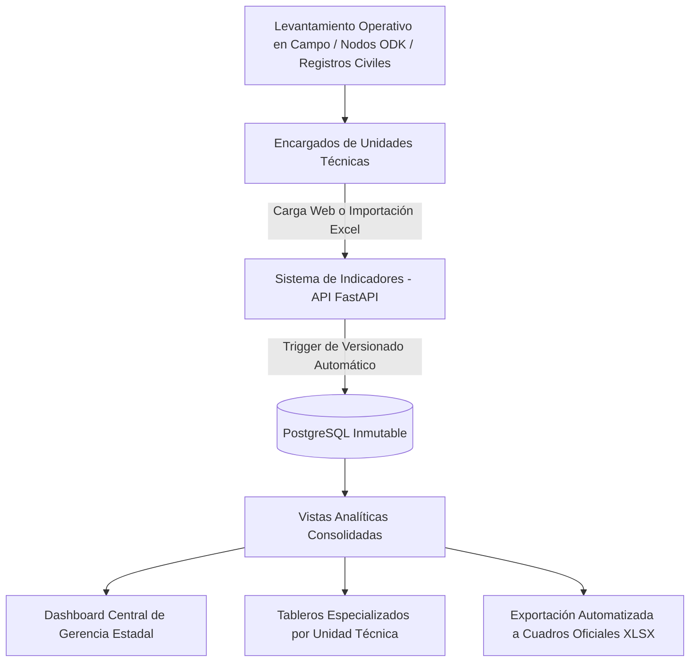
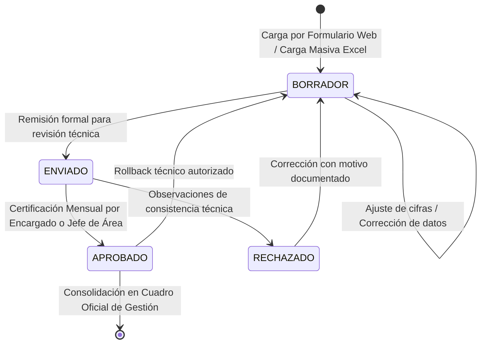

# 📊 Sistema de Indicadores de Gestión — INE Estado Monagas
## Documento Maestro de Lógica de Negocio y Reglas Operativas

> **Organismo:** Instituto Nacional de Estadística (INE) — República Bolivariana de Venezuela  
> **Ámbito Territorial:** Gerencia Estadal Monagas (Entidad Federal 16)  
> **Documento Fuente Base:** `Cuadros Informe Mensual de Gestion Gerencias Estadales MONAGAS AGOSTO 2026.xlsx`  
> **Versión del Sistema:** 1.0 (Producción)  
> **Destino:** Repositorio GitHub / Documentación de Arquitectura de Negocio  

---

## 📑 Tabla de Contenidos

1. [Visión General y Propósito del Sistema](#1-visión-general-y-propósito-del-sistema)
2. [Problema Operativo y Solución de Negocio](#2-problema-operativo-y-solución-de-negocio)
3. [Estructura Organizacional de Unidades Técnicas](#3-estructura-organizacional-de-unidades-técnicas)
4. [Catálogo de Indicadores y Fórmulas Matemáticas](#4-catálogo-de-indicadores-y-fórmulas-matemáticas)
   - [4.1 Unidad de Estadísticas Sociales (SOC)](#41-unidad-de-estadísticas-sociales-soc)
   - [4.2 Unidad de Estadísticas Demográficas y Hechos Vitales (DEM)](#42-unidad-de-estadísticas-demográficas-y-hechos-vitales-dem)
   - [4.3 Unidad de Estadísticas Económicas y Precios (ECO)](#43-unidad-de-estadísticas-económicas-y-precios-eco)
   - [4.4 Unidad de Cartografía Estadística y Circuitos Comunales (CART)](#44-unidad-de-cartografía-estadística-y-circuitos-comunales-cart)
   - [4.5 Unidad de Estructura y Operaciones Digitales SEGEN (SEG)](#45-unidad-de-estructura-y-operaciones-digitales-segen-seg)
   - [4.6 Coordinación de SEEM y Gerencia Estadal (SEEM / GER)](#46-coordinación-de-seem-y-gerencia-estadal-seem--ger)
5. [Modelo de Gobernanza y Control de Acceso (RBAC)](#5-modelo-de-gobernanza-y-control-de-acceso-rbac)
6. [Ciclo de Vida de las Mediciones y Flujo de Certificación](#6-ciclo-de-vida-de-las-mediciones-y-flujo-de-certificación)
7. [Motor de Auditoría, Versionado e Inmutabilidad](#7-motor-de-auditoría-versionado-e-inmutabilidad)
8. [Dimensión Territorial y Desglose Municipal](#8-dimensión-territorial-y-desglose-municipal)
9. [Interoperabilidad y Procesamiento de Hojas de Cálculo](#9-interoperabilidad-y-procesamiento-de-hojas-de-cálculo)
10. [Consolidación de Métricas y Vistas Ejecutivas](#10-consolidación-de-métricas-y-vistas-ejecutivas)
11. [Glosario de Términos Institucionales](#11-glosario-de-términos-institucionales)

---

## 1. Visión General y Propósito del Sistema

El **Sistema de Indicadores de Gestión** es una plataforma tecnológica diseñada para centralizar, procesar, auditar y visualizar las operaciones estadísticas del **Instituto Nacional de Estadística (INE)** en la **Gerencia Estadal del Estado Monagas (Entidad 16)**.

El objetivo medular del sistema es sustituir la gestión fragmentada basada en libros de cálculo Excel multidimensionales por un modelo relacional centralizado con integridad transaccional, trazabilidad histórica estricta y acceso jerarquizado por roles.



---

## 2. Problema Operativo y Solución de Negocio

### 2.1 El Diagnóstico Previo
Tradicionalmente, la Gerencia Estadal de Monagas reportaba mensualmente su gestión a la Dirección Nacional mediante el archivo maestro:
`Cuadros Informe Mensual de Gestion Gerencias Estadales MONAGAS AGOSTO 2026.xlsx`.

Este procedimiento manual generaba los siguientes riesgos operativos:
- **Riesgo de Sobre-escritura Accidental:** Pérdida de versiones intermedias y falta de autoría al modificar celdas críticas.
- **Asincronía de Cierre:** Las unidades técnicas cerraban sus cifras en fechas dispares sin control formal de congelamiento.
- **Ausencia de Auditoría de Cambios:** Si una cifra histórica de nacimientos o precios variaba, era imposible conocer quién, cuándo y por qué ejecutó la corrección.
- **Dificultad de Consolidación:** La Dirección General no contaba con una visión en tiempo real del cumplimiento de metas globales del estado sin consolidar manualmente 10 pestañas de cálculo.

### 2.2 La Solución Implementada
La plataforma resuelve este escenario mediante:
1. **Modelado Relacional Normalizado:** Estandarización de más de 29 indicadores oficiales organizados en 5 departamentos clave y 1 unidad de coordinación.
2. **Control de Acceso Basado en Roles (RBAC):** Separación tajante entre la supervisión estratégica (Gerencia Estadal) y la carga operativa (Jefes de Unidad).
3. **Flujo de Certificación Mensual:** Congelamiento formal de cifras por departamento y período.
4. **Historial de Versiones con Reversión (Rollback):** Capacidad de retornar a versiones anteriores con justificación obligatoria y auditoría inmutable en base de datos.
5. **Bidireccionalidad Excel-Web:** Compatibilidad total con las plantillas originales del INE para importación masiva y exportación ejecutiva.

---

## 3. Estructura Organizacional de Unidades Técnicas

El sistema refleja fielmente el organigrama operativo del INE Monagas, dividiendo las responsabilidades funcionales en **5 Unidades Técnicas Operativas** y **1 Unidad de Coordinación y Gestión**:

```
┌────────────────────────────────────────────────────────────────────────────────────────┐
│                   GERENCIA ESTADAL MONAGAS · INE (ENTIDAD FEDERAL 16)                  │
├────────────────────┬────────────────────┬────────────────────┬─────────────────────────┤
│ 1. SOC             │ 2. DEM             │ 3. ECO             │ 4. CART                 │
│ Estadísticas       │ Estadísticas       │ Estadísticas       │ Cartografía Estadística │
│ Sociales           │ Demográficas       │ Económicas         │ y Circuitos Comunales   │
├────────────────────┴────────────────────┴────────────────────┴─────────────────────────┤
│ 5. SEG (SEGEN)                                                                         │
│ Estructura, Nodos Territoriales y Encuestas Digitales del SEGEN                       │
├────────────────────────────────────────────────────────────────────────────────────────┤
│ 6. SEEM / GER                                                                          │
│ Seguimiento, Evaluación, Educación Metodológica, Capacitación y Comités Estadales       │
└────────────────────────────────────────────────────────────────────────────────────────┘
```

---

## 4. Catálogo de Indicadores y Fórmulas Matemáticas

Cada indicador cuenta con un código único estandarizado, unidad de medida, frecuencia, fórmula matemática de cálculo y orientación de meta.

### 4.1 Unidad de Estadísticas Sociales (`SOC`)
* **Misión Operativa:** Monitorear el bienestar socioeconómico de los hogares mediante muestreos probabilísticos en campo.
* **Proyectos:** Encuesta de Hogares por Muestreo (EHM) y Encuesta de Seguimiento al Consumo de Alimentos (ESCA).

| Código | Indicador | Fórmula de Cálculo | Unidad | Tipo Meta | Criterio de Calidad |
|---|---|---|---|---|---|
| **`SOC-EHM-01`** | **Tasa de Levantamiento EHM** | $$\frac{\text{Controles Levantados}}{\text{Controles Planificados}} \times 100$$ | `%` | Ascendente | Meta institucional: $100\%$ mensual. |
| **`SOC-EHM-02`** | **Viviendas Efectivas EHM** | $$\sum \text{Viviendas Efectivas Investigadas}$$ | Viviendas | Ascendente | Entrevistas completadas satisfactoriamente. |
| **`SOC-EHM-03`** | **Tasa de No Respuesta EHM** | $$\frac{\text{Viviendas Tipo A}}{\text{Viviendas Efectivas} + \text{Tipo A}} \times 100$$ | `%` | Descendente | **Umbral de Alerta:** Debe ser $\le 15\%$. (Tipo A: Rechazos, ausencias). |
| **`SOC-ESCA-01`** | **Tasa de Levantamiento ESCA** | $$\frac{\text{Controles Levantados ESCA}}{\text{Controles Planificados ESCA}} \times 100$$ | `%` | Ascendente | Cobertura de la muestra alimentaria. Meta: $100\%$. |
| **`SOC-ESCA-02`** | **Viviendas Efectivas ESCA** | $$\sum \text{Viviendas Efectivas ESCA}$$ | Viviendas | Ascendente | Hogares con diario de adquisición alimentaria. |
| **`SOC-ESCA-03`** | **Tasa de No Respuesta ESCA** | $$\frac{\text{Viviendas Tipo A}}{\text{Viviendas Efectivas} + \text{Tipo A}} \times 100$$ | `%` | Descendente | **Umbral de Alerta:** Debe ser $\le 20\%$. |

> **Regla de Clasificación de Viviendas:**
> - **Efectivas:** Entrevista completa realizada con informante calificado.
> - **Tipo A (No Respuesta Imputable):** Rechazo del hogar, informante ausente tras múltiples visitas programadas.
> - **Tipo B (No Respuesta No Imputable):** Vivienda desocupada temporalmente, en construcción o uso comercial no previsto.
> - **Tipo C (Exclusiones del Marco):** Vivienda demolida, destruida por desastre o fusionada.

---

### 4.2 Unidad de Estadísticas Demográficas y Hechos Vitales (`DEM`)
* **Misión Operativa:** Consolidar el registro continuo de hechos vitales ocurrido en centros de salud y registros civiles del estado Monagas, así como gestionar el flujo físico y digital de boletas.

| Código | Indicador | Fórmula de Cálculo | Unidad | Tipo Meta | Propósito Estadístico |
|---|---|---|---|---|---|
| **`DEM-VIT-01`** | **Volumen de Boletas Recolectadas** | $$\text{Nac.} + \text{Def.} + \text{Matr.} + \text{Uniones} + \text{Div.} + \text{Suic.}$$ | Boletas | Continua | Flujo total bruto de actas captadas en el estado. |
| **`DEM-VIT-02`** | **Nacimientos Registrados** | $$\sum \text{Actas de Nacimiento}$$ | Actas | Continua | Monitoreo de fecundidad y natalidad oficial. |
| **`DEM-VIT-03`** | **Defunciones Registradas** | $$\sum \text{Actas de Defunción}$$ | Actas | Continua | Mortalidad general y materna/infantil en salud pública. |
| **`DEM-VIT-04`** | **Nupcialidad y Uniones Estables** | $$\sum \text{Matrimonios} + \sum \text{Uniones Estables}$$ | Actos | Continua | Composición civil de las familias. |
| **`DEM-VIT-05`** | **Tasa de Transcripción Digital** | $$\frac{\text{Boletas Transcritas}}{\text{Boletas Recolectadas}} \times 100$$ | `%` | Ascendente | Meta obligatoria: $100\%$ (Cero rezago acumulado). |

---

### 4.3 Unidad de Estadísticas Económicas y Precios (`ECO`)
* **Misión Operativa:** Monitorear el Directorio Nacional de Establecimientos y relevar los precios para la elaboración de la Canasta Alimentaria Normativa (CAN) y los Índices Nacionales de Precios al Consumidor (INPC).

| Código | Indicador | Fórmula de Cálculo | Unidad | Tipo Meta | Impacto Operativo |
|---|---|---|---|---|---|
| **`ECO-PRE-01`** | **Efectividad Personal en Campo** | $$\frac{\text{Personal en Levantamiento}}{\text{Personal Planificado}} \times 100$$ | `%` | Ascendente | Cobertura del despliegue de encuestadores de precios. |
| **`ECO-DIR-01`** | **Establecimientos Implantados** | $$\sum \text{Nuevas Unidades Comerciales Incorporadas}$$ | Locales | Ascendente | Actualización del marco muestral de tipologías de venta. |
| **`ECO-CAN-04`** | **Comunas Cubiertas por la CAN** | $$\sum \text{Comunas con Levantamiento Activo de Precios}$$ | Comunas | Ascendente | Representatividad territorial comunal (Meta: $\ge 25$). |
| **`ECO-CAN-01`** | **Efectividad Muestral CAN** | $$\frac{\text{Establecimientos Efectivos}}{\text{Establecimientos Planificados}} \times 100$$ | `%` | Ascendente | Cobertura en establecimientos clave (Meta: $100\%$). |
| **`ECO-CAN-02`** | **Precios Relevados Efectivos** | $$\sum \text{Cotizaciones de Productos Levantadas}$$ | Precios | Ascendente | Volumen total de cotizaciones de la canasta normativa. |
| **`ECO-CAN-03`** | **Calidad de Precios Sin Errores** | $$\frac{\text{Precios Sin Incidencias Técnicas}}{\text{Precios Totales Capturados}} \times 100$$ | `%` | Ascendente | Meta de consistencia técnica: $\ge 99.0\%$. |

---

### 4.4 Unidad de Cartografía Estadística y Circuitos Comunales (`CART`)
* **Misión Operativa:** Actualizar el marco geográfico estadístico del estado Monagas, integrando la delimitación de Circuitos Electorales Comunales y Consejos Comunales en coordinación con el Instituto Geográfico de Venezuela Simón Bolívar (IGVSB).

| Código | Indicador | Fórmula de Cálculo | Unidad | Tipo Meta | Requisito Cartográfico |
|---|---|---|---|---|---|
| **`CART-CIR-01`** | **Tasa de Vectorización Comunal** | $$\frac{\text{Circuitos Vectorizados}}{\text{Total Circuitos Planificados}} \times 100$$ | `%` | Ascendente | Poligonales digitalizadas y validadas en GIS. |
| **`CART-CIR-02`** | **Consejos Comunales Integrados** | $$\sum \text{Consejos Comunales Georreferenciados}$$ | Consejos | Ascendente | Vinculación espacial dentro de los 199 circuitos. |
| **`CART-CIR-03`** | **Completitud Vectorial Plena** | $$\sum \text{Circuitos con Cierre Poligonal al 100\%}$$ | Circuitos | Ascendente | Polígonos cerrados sin solapamiento ni vértices libres. |
| **`CART-MUN-01`** | **Cobertura Municipal Cartográfica** | $$\sum \text{Municipios con Actualización Cartográfica}$$ | Municipios | Ascendente | Cobertura total de los 13 municipios del estado Monagas. |

---

### 4.5 Unidad de Estructura y Operaciones Digitales SEGEN (`SEG`)
* **Misión Operativa:** Administrar la infraestructura física, tecnológica y humana del **Sistema Estadístico y Geográfico Nacional (SEGEN)**, desplegando dispositivos móviles (DMC) y procesando encuestas electrónicas en Open Data Kit (ODK).

| Código | Indicador | Fórmula de Cálculo | Unidad | Tipo Meta | Estándar de Operación |
|---|---|---|---|---|---|
| **`SEG-NOD-01`** | **Tasa de Operatividad de Nodos** | $$\frac{\text{Nodos Activos en Operación}}{\text{Nodos Físicos Instalados}} \times 100$$ | `%` | Ascendente | Umbral óptimo de transmisión: $\ge 80\%$. |
| **`SEG-NOD-02`** | **Cumplimiento de Despliegue** | $$\frac{\text{Nodos Instalados}}{\text{Nodos Programados}} \times 100$$ | `%` | Ascendente | Despliegue en los 13 municipios (Meta: $100\%$). |
| **`SEG-PAR-01`** | **Dispositivos DMC Operativos** | $$\sum \text{Dispositivos Móviles Activos en Campo}$$ | Equipos | Ascendente | Parque tecnológico disponible para capturas digitales. |
| **`SEG-PER-01`** | **Fuerza Territorial Desplegada** | $$\text{Coord. Mun.} + \text{Coord. Nodos} + \text{Superv.} + \text{Encuest.}$$ | Personas | Ascendente | Contingente operativo en territorio. |
| **`SEG-ENC-01`** | **Volumen Global Encuestas ODK** | $$\sum \text{Formularios Digitales Procesados en el Mes}$$ | Encuestas | Ascendente | Producción total de investigaciones SEGEN. |
| **`SEG-ENC-02`** | **Formularios Conteo Rápido v2** | $$\sum \text{Registros Intercensales Conteo Rápido}$$ | Encuestas | Ascendente | Actualización del inventario de estructuras. |
| **`SEG-ENC-03`** | **Encuestas Coyuntura y Laboral** | $$\sum (\text{Coyuntura} + \text{Laboral} + \text{Económica ODK})$$ | Encuestas | Ascendente | Captura de dinámicas productivas y laborales. |

---

### 4.6 Coordinación de SEEM y Gerencia Estadal (`SEEM` / `GER`)
* **Misión Operativa:** Desarrollar el talento humano institucional, coordinar comités interinstitucionales y monitorear la planta funcional.

| Código | Indicador | Fórmula de Cálculo | Unidad | Tipo Meta |
|---|---|---|---|---|
| **`SEG-CAP-01`** | **Personal Capacitado en Metodología** | $$\sum \text{Funcionarios Formados en Talleres del Mes}$$ | Personas | Ascendente |
| **`GER-CCEE-01`** | **Sesiones Comité de Coordinación (CCEE)** | $$\sum \text{Mesas Técnicas Interinstitucionales (CNE, Salud)}$$ | Sesiones | Ascendente |
| **`GER-TAL-01`** | **Planta de Personal Activa** | $$\text{Fijos Activos} + \text{Contratados Activos}$$ | Trabajadores | Ascendente |

---

## 5. Modelo de Gobernanza y Control de Acceso (RBAC)

Para evitar alteraciones no autorizadas y garantizar una auditoría limpia, el sistema implementa una matriz estricta de **Control de Acceso Basado en Roles (RBAC)**:

```
┌────────────────────────────────────────────────────────────────────────────────────────┐
│                               MATRIZ DE ROLES Y PRIVILEGIOS                            │
├─────────────┬──────────────────────────────────────────────────────────────────────────┤
│ ROL         │ PRIVILEGIOS Y ALCANCE OPERATIVO                                          │
├─────────────┼──────────────────────────────────────────────────────────────────────────┤
│ ADMIN       │ • Acceso global al sistema y gestión de usuarios/roles.                  │
│             │ • Configuración de indicadores, metas maestras y municipios.             │
│             │ • Consulta y ejecución técnica de auditorías de base de datos.           │
├─────────────┼──────────────────────────────────────────────────────────────────────────┤
│ GERENTE     │ • Acceso de SUPERVISIÓN Y CONSULTA ESTRATÉGICA (Solo Lectura).           │
│             │ • Visualización del Resumen Consolidado Estadal y Dashboards por Unidad. │
│             │ • Exportación de cuadros oficiales e informes mensuales.                 │
│             │ • NO tiene permitido alterar cifras operativas ni aprobar mediciones.     │
├─────────────┼──────────────────────────────────────────────────────────────────────────┤
│ JEFE_AREA   │ • Supervisión técnica sobre múltiples unidades asignadas.                │
│             │ • Revisión, validación y certificación formal de cifras de sus unidades. │
│             │ • Inspección del historial de auditoría y comparación de versiones.      │
├─────────────┼──────────────────────────────────────────────────────────────────────────┤
│ ENCARGADO   │ • Responsable operativo directo de SU UNIDAD TÉCNICA asignada.           │
│             │ • Carga de mediciones (vía web interactiva o carga masiva Excel).        │
│             │ • Certificación mensual oficial de los indicadores de su departamento.   │
│             │ • Restringido: NO puede ver ni modificar mediciones de otros deptos.    │
└─────────────┴──────────────────────────────────────────────────────────────────────────┘
```

> [!IMPORTANT]
> **Separación de Responsabilidades:** El `GERENTE` no interviene operativamente en la carga ni modificación de datos. Esto garantiza que la máxima autoridad estadal supervise informes consolidados sin riesgo de inducir alteraciones en las fuentes primarias de datos.

---

## 6. Ciclo de Vida de las Mediciones y Flujo de Certificación

Toda medición registrada transita por un ciclo de vida normado para garantizar que ninguna cifra preliminar afecte los informes oficiales:



### 6.1 Reglas de Certificación Mensual en Bloque
1. **Puntualidad del Período:** Las mediciones se imputan a un año (`periodo_anio`) y un mes (`periodo_mes`).
2. **Endpoint de Certificación:** Se ejecuta mediante `POST /api/v1/mediciones/unidad/{dept_code}/certificar`.
3. **Validación de Integridad:** El sistema verifica que existan mediciones cargadas para el departamento en dicho período.
4. **Sello Oficial Inmutable:** Todas las mediciones pasan a estado `APROBADO`, estampando el ID del usuario certificador, su cédula, su nombre y la fecha exacta en UTC.
5. **Impacto en el Dashboard:** Solo las mediciones en estado `APROBADO` son computadas en el porcentaje de cumplimiento oficial consolidado del estado.

---

## 7. Motor de Auditoría, Versionado e Inmutabilidad

Cualquier cambio sobre una cifra estadística (`valor_registrado`), meta (`meta_periodo`) o estado (`estado`) debe ser auditable a perpetuidad.

### 7.1 Mecanismo de Base de Datos (PostgreSQL Triggers)
El sistema no confía exclusivamente en la lógica de la aplicación; la auditoría está blindada a nivel de motor de base de datos mediante triggers en PL/pgSQL:

```sql
-- Trigger 1: Incrementa el número de versión automáticamente ante cambios sustantivos
CREATE TRIGGER trg_incrementar_version_medicion
BEFORE UPDATE ON mediciones_indicador
FOR EACH ROW
EXECUTE FUNCTION trg_fn_incrementar_version_medicion();

-- Trigger 2: Genera un snapshot inmutable en versiones_medicion
CREATE TRIGGER trg_guardar_version_medicion
AFTER INSERT OR UPDATE ON mediciones_indicador
FOR EACH ROW
EXECUTE FUNCTION trg_fn_guardar_version_medicion();
```

### 7.2 Función de Reversión Controlada (`fn_revertir_medicion`)
Si una auditoría detecta un error de transcripción en una cifra ya certificada, el sistema prohíbe el borrado físico (`DELETE`). En su lugar, ejecuta una reversión histórica:

```sql
SELECT fn_revertir_medicion(
    p_medicion_id    := 'f47ac10b-58cc-4372-a567-0e02b2c3d479',
    p_version_destino:= 1,
    p_usuario_id     := 'a0eebc99-9c0b-4ef8-bb6d-6bb9bd380a11',
    p_motivo         := 'Corrección técnica autorizada por la Gerencia Estadal'
);
```

**Resultado de la Reversión:**
- Se restaura el valor y la meta de la versión destino.
- Se genera una **nueva versión incremental** (ej. Versión 3) documentando que corresponde a un rollback de la Versión 1.
- El historial previo se mantiene intacto (Append-Only Audit Log).

### 7.3 Servicio de Diagnóstico y Comparación (`get_version_diff`)
Permite calcular el delta numérico exacto entre dos versiones de un indicador:
$$\Delta_{\text{valor}} = \text{Valor}_{\text{Versión } B} - \text{Valor}_{\text{Versión } A}$$

---

## 8. Dimensión Territorial y Desglose Municipal

El estado Monagas está integrado por **13 Municipios**. El sistema soporta mediciones a dos niveles geográficos:
1. **Consolidado Estadal (`municipio_id = NULL`):** Utilizado para indicadores macro (EHM, ESCA, Precios CAN generales).
2. **Desglose Municipal (`municipio_id = 1..13`):** Utilizado en Cartografía Comunal, Nodos SEGEN y Estadísticas Vitales.

### Codificación Oficial INE DPT (Entidad 16 - Monagas)

| ID | Código INE | Nombre del Municipio | Capital Municipal | Nodos SEGEN |
|---|---|---|---|---|
| **1** | `1601` | **Acosta** | San Antonio de Capayacuar | 5 nodos |
| **2** | `1602` | **Aguasay** | Aguasay | 4 nodos |
| **3** | `1603` | **Bolívar** | Caripito | 7 nodos |
| **4** | `1604` | **Caripe** | Caripe | 8 nodos |
| **5** | `1605` | **Cedeño** | Caicara de Maturín | 7 nodos |
| **6** | `1606` | **Ezequiel Zamora** | Punta de Mata | 8 nodos |
| **7** | `1607` | **Libertador** | Temblador | 6 nodos |
| **8** | `1608` | **Maturín** | Maturín *(Sede Gerencia Estadal)* | 35 nodos |
| **9** | `1609` | **Piar** | Aragua de Maturín | 7 nodos |
| **10** | `1610` | **Punceres** | Quiriquire | 5 nodos |
| **11** | `1611` | **Santa Bárbara** | Santa Bárbara | 4 nodos |
| **12** | `1612` | **Sotillo** | Barrancas del Orinoco | 5 nodos |
| **13** | `1613` | **Uracoa** | Uracoa | 5 nodos |

---

## 9. Interoperabilidad y Procesamiento de Hojas de Cálculo

El sistema incorpora un motor bidireccional para convivir con los procesos tradicionales del INE:

### 9.1 Motor de Importación Masiva (`excelParser.ts`)
- **Lectura Automática de Estructuras:** Detecta el formato de cada hoja del libro maestro (`LA 1`, `LA 2`, `LA 3`, etc.).
- **Validación Sintáctica y Semántica:** Valida que las columnas numéricas no contengan texto corrupto y que los porcentajes guarden consistencia matemática.
- **Carga Atómica (`POST /api/v1/mediciones/batch`):** Inserta nuevas mediciones o actualiza existentes en una única transacción de base de datos (`db.commit()`), garantizando que no queden cargas a medias.

### 9.2 Motor de Exportación Oficial (`exportCuadrosXLSX.ts`)
- **Fidelidad Institucional:** Genera libros Excel formateados idénticos a los cuadros requeridos por el nivel central en Caracas:
  - `INE_Monagas_ECO_Levantamiento_CAN_2026.xlsx`
  - `INE_Monagas_SOC_Estadisticas_Sociales_2026.xlsx`
  - `INE_Monagas_DEM_Estadisticas_Vitales_2026.xlsx`
  - `INE_Monagas_CART_Circuitos_Comunales_2026.xlsx`
  - `INE_Monagas_SEG_Estructura_y_Encuestas_2026.xlsx`

---

## 10. Consolidación de Métricas y Vistas Ejecutivas

Para alimentar los tableros analíticos en tiempo real con latencia inferior a 50ms, la base de datos implementa la vista analítica materializada `v_dashboard_central_resumen`:

```sql
CREATE OR REPLACE VIEW v_dashboard_central_resumen AS
SELECT 
    d.id AS departamento_id,
    d.codigo AS departamento_codigo,
    d.nombre AS departamento_nombre,
    COUNT(DISTINCT i.id) AS total_indicadores,
    COUNT(m.id) AS total_mediciones_registradas,
    COUNT(CASE WHEN m.estado = 'APROBADO' THEN 1 END) AS mediciones_aprobadas,
    COUNT(CASE WHEN m.estado = 'ENVIADO' THEN 1 END) AS mediciones_pendientes_aprobacion,
    ROUND(
        AVG(
            CASE 
                WHEN m.meta_periodo > 0 AND m.estado = 'APROBADO' 
                THEN (m.valor_registrado / m.meta_periodo) * 100 
                ELSE NULL 
            END
        ), 2
    ) AS porcentaje_cumplimiento_promedio
FROM departamentos d
LEFT JOIN indicadores i ON d.id = i.departamento_id AND i.activo = TRUE
LEFT JOIN mediciones_indicador m ON i.id = m.indicador_id
GROUP BY d.id, d.codigo, d.nombre;
```

### Cálculo del Cumplimiento General Estadal:
$$\text{Cumplimiento Global} = \frac{1}{N} \sum_{k=1}^{N} \text{Cumplimiento Promedio}(\text{Departamento}_k)$$

Donde solo intervienen las unidades con metas activas y mediciones certificadas en estado `APROBADO`.

---

## 11. Glosario de Términos Institucionales

- **Boleta Vital:** Formulario legal físico (nacimiento, defunción, matrimonio) llenado en hospitales y registros civiles, remitido al INE para codificación y procesamiento demográfico.
- **CAN (Canasta Alimentaria Normativa):** Conjunto de alimentos básicos ponderados para medir el costo de la alimentación mínima de una familia normativa en Venezuela.
- **CCEE (Comité de Coordinación Estadística Estadal):** Instancia de articulación entre el INE, Gobernación, Ministerios y CNE para armonizar las cifras oficiales regionales.
- **Circuito Comunal:** Delimitación territorial electoral y sociopolítica que agrupa varios Consejos Comunales para proyectos de inversión y gestión comunitaria.
- **Control Muestral:** Conjunto de viviendas o sectores seleccionados estadísticamente para ser visitados por un encuestador durante una semana operativa.
- **DMC (Dispositivo Móvil de Captura):** Tablet o smartphone corporativo con georreferenciación y software ODK utilizado para encuestas digitales en campo.
- **EHM (Encuesta de Hogares por Muestreo):** Investigación estadística continua de alcance nacional que monitorea empleo, desempleo, ingresos y condiciones del hogar.
- **ESCA (Encuesta de Seguimiento al Consumo de Alimentos):** Estudio estadístico especializado en hábitos de compra y calorías consumidas por la población.
- **Nodo SEGEN:** Punto físico comunitario o parroquial equipado tecnológicamente para la transmisión y captura de estadísticas locales.
- **ODK (Open Data Kit):** Plataforma de código abierto para recolección de datos en dispositivos móviles sin necesidad de conexión continua a internet.
- **Poligonal:** Figura geométrica cerrada georreferenciada en GIS que delimita formalmente el perímetro territorial de una comuna o municipio.
- **SEGEN (Sistema Estadístico y Geográfico Nacional):** Red nacional que integra la información estadística territorial de la República.
- **Vivienda Tipo A:** Vivienda seleccionada en muestra donde no fue posible realizar la entrevista por rechazo explícito o ausencia prolongada de los ocupantes.
