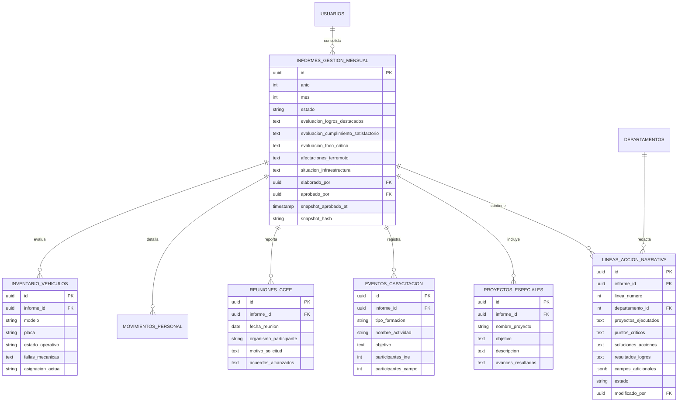

# 📑 ESPECIFICACIÓN DE REQUISITOS DE SOFTWARE (SRS)
## Sistema Integral de Indicadores de Gestión y Generación de Informes Mensuales
### Instituto Nacional de Estadística (INE) — Gerencia Estadal Monagas (Entidad Federal 16)

---

| Metadato Institucional | Valor Normativo |
|---|---|
| **Código del Documento:** | `SRS-INE-MON-2026-V1` |
| **Estándar de Ingeniería:** | ISO/IEC/IEEE 29148:2018 / IEEE 830-1998 |
| **Documentos Fuente Oficiales:** | • `FORMATO INFORME DE GESTION GERENCIAS ESTADALES JULIO 2026.docx`<br>• `Cuadros Informe Mensual de Gestion Gerencias Estadales MONAGAS AGOSTO 2026.xlsx` |
| **Organismo:** | Instituto Nacional de Estadística (INE) de la República Bolivariana de Venezuela |
| **Unidad Territorial:** | Gerencia Estadal Monagas (Entidad Federal 16) |
| **Rol Redactor:** | Tech Lead / Arquitecto de Software |
| **Estado:** | Aprobado para Implementación Técnica |

---

## 📑 ÍNDICE GENERAL

1. [INTRODUCCIÓN](#1-introducción)
   - 1.1 Propósito y Justificación
   - 1.2 Alcance del Sistema
   - 1.3 Personal Involucrado y Stakeholders
   - 1.4 Definiciones, Acrónimos y Abreviaturas
   - 1.5 Referencias Normativas e Institucionales
2. [DESCRIPCIÓN GENERAL DEL PRODUCTO](#2-descripción-general-del-producto)
   - 2.1 Perspectiva del Producto y Arquitectura Dual (Cuantitativa + Cualitativa)
   - 2.2 Macrofunciones del Sistema
   - 2.3 Matriz de Perfiles de Usuario y Roles (RBAC)
   - 2.4 Restricciones Operativas, Tecnológicas y de Diseño
   - 2.5 Supuestos y Dependencias
3. [REQUERIMIENTOS ESPECÍFICOS DEL SISTEMA (FUNCIONALES)](#3-requerimientos-específicos-del-sistema-funcionales)
   - 3.1 Módulo Transversal de Autenticación, Seguridad y RBAC (`RF-SEC`)
   - 3.2 Módulo de Gestión Cuantitativa de Indicadores y Cuadros Oficiales (`RF-MET`)
   - 3.3 Módulo de Gestión Cualitativa y Narrativa Operativa (12 Líneas de Acción) (`RF-LA`)
   - 3.4 Módulo de Flujo de Trabajo (Workflow), Aprobación y Snapshots Inmutables (`RF-WFL`)
   - 3.5 Módulo Generador y Ensamblador del Informe Oficial Word (`.docx`) y PDF (`RF-REP`)
   - 3.6 Módulo de Visualización e Interfaz de Usuario (Dashboards) (`RF-UI`)
4. [MODELO DE INFORMACIÓN Y REQUERIMIENTOS DE DATOS](#4-modelo-de-información-y-requerimientos-de-datos)
   - 4.1 Entidades Cuantitativas Existentes
   - 4.2 Entidades Cualitativas Propuestas para el Informe de Gestión
   - 4.3 Diccionario de Datos y Reglas de Integridad
5. [REQUERIMIENTOS NO FUNCIONALES (NFR)](#5-requerimientos-no-funcionales-nfr)
   - 5.1 Rendimiento, Latencia y Capacidad
   - 5.2 Seguridad, Criptografía y Trazabilidad Forense
   - 5.3 Confiabilidad, Tolerancia a Fallos y Reintentos
   - 5.4 Sistema de Diseño Editorial y Usabilidad (Norma Cero Emojis en UI)
   - 5.5 Portabilidad, Despliegue en Cloud (Render) y Docker
6. [MATRIZ DE TRAZABILIDAD DE REQUISITOS (RTM)](#6-matriz-de-trazabilidad-de-requisitos-rtm)
7. [PLAN DE DESPLIEGUE Y ETAPAS DE IMPLEMENTACIÓN](#7-plan-de-despliegue-y-etapas-de-implementación)

---

## 1. INTRODUCCIÓN

### 1.1 Propósito y Justificación
El presente documento de **Especificación de Requisitos de Software (SRS)** establece los fundamentos funcionales, arquitectónicos, operativos y no funcionales para el desarrollo e implementación del **Sistema Integral de Indicadores de Gestión y Generación de Informes Mensuales** del **Instituto Nacional de Estadística (INE) — Gerencia Estadal Monagas (Entidad Federal 16)**.

Históricamente, la Gerencia Estadal de Monagas ha recopilado sus métricas operativas en un libro de cálculo maestro multidepartamental (`Cuadros Informe Mensual de Gestion Gerencias Estadales MONAGAS AGOSTO 2026.xlsx`) y ha redactado manualmente un informe cualitativo y narrativo estructurado en Microsoft Word (`FORMATO INFORME DE GESTION GERENCIAS ESTADALES JULIO 2026.docx`) para rendir cuentas a la Dirección Central del INE en Caracas. Este proceso manual generaba:
1. Discrepancias entre las cifras cuantitativas de los cuadros y las descripciones narrativas del informe.
2. Retardos significativos en la consolidación de las 12 Líneas de Acción mensuales.
3. Vulnerabilidad ante pérdidas de versiones, sobreescrituras no auditadas y falta de trazabilidad.
4. Elevado costo en horas-hombre invertidas en formateo de tablas y maquetación de documentos Word/PDF.

El propósito central de este software es unificar la **captura cuantitativa** de los 29 indicadores oficiales con la **captura cualitativa** de las 12 Líneas de Acción, dotando a la Gerencia de un motor automatizado que genere en un solo clic el **Informe Oficial de Gestión en formato `.docx` (Word nativo idéntico al oficial) y `.pdf`**, respaldado por auditoría inmutable, control de versiones y tableros interactivos para la toma de decisiones.

### 1.2 Alcance del Sistema
El sistema abarca la totalidad de las operaciones estadísticas, territoriales y administrativas de la Gerencia Estadal Monagas:
* **Ámbito Geográfico:** Estado Monagas, desagregado en sus 13 municipios (Maturín, Caripe, Bolívar, Cedeño, Ezequiel Zamora, Libertador, Piar, Punceres, Acosta, Aguasay, Santa Bárbara, Sotillo y Uracoa).
* **Unidades Técnicas Operativas:**
  1. **SOC:** Estadísticas Sociales (Encuesta de Hogares por Muestreo - EHM, Encuesta de Seguimiento al Consumo de Alimentos - ESCA).
  2. **DEM:** Estadísticas Demográficas y Vitales (Nacimientos, Defunciones, Matrimonios, Uniones Estables, Divorcios, Suicidios, Flujo de Boletas y Rezago).
  3. **ECO:** Estadísticas Económicas y Gerencia de Precios (Directorio de Tipologías de Establecimientos, Canasta Alimentaria Normativa - CAN).
  4. **CART:** Cartografía Estadística y Circuitos Comunales (Vectorización de Comunas, Poligonales, Georreferenciación de Consejos Comunales).
  5. **SEG (SEGEN):** Sistema Estadístico y Geográfico Nacional (Red de Nodos, Parque Tecnológico DMC/Laptops/Multibams, Formularios Digitales ODK: Conteo Rápido v2, Coyuntura, Laboral, Económica, Servicios).
  6. **SEEM / RRHH / GER:** Seguimiento, Evaluación, Educación Metodológica (Capacitación), Comités Estadales (CCEE), Talento Humano, Desempeño General y Condiciones Físicas de la Sede Regional.

### 1.3 Personal Involucrado y Stakeholders
* **Dirección Nacional del INE (Caracas):** Destinatario final de los reportes consolidados mensuales en formato Word y PDF normativo.
* **Gerente Estadal Monagas:** Máxima autoridad regional; supervisa dashboards, redacta conclusiones estratégicas (Líneas 7, 11 y 12), evalúa el desempeño de las unidades, aprueba/congela períodos mensuales y autoriza rollbacks auditados.
* **Jefes de Unidad Técnica (SOC, DEM, ECO, CART, SEG, SEEM/RRHH):** Responsables directos de ingresar datos métricos, justificar desvíos, documentar proyectos ejecutados, puntos críticos, soluciones y logros específicos de su departamento.
* **Coordinadores Municipales y de Nodo SEGEN:** Operadores que suministran partes de campo y avances territoriales.
* **Administrador del Sistema:** Responsable del mantenimiento de la plataforma, roles, usuarios, parámetros globales y monitoreo de infraestructura en la nube.

### 1.4 Definiciones, Acrónimos y Abreviaturas
* **INE:** Instituto Nacional de Estadística de Venezuela.
* **SEGEN:** Sistema Estadístico y Geográfico Nacional.
* **EHM:** Encuesta de Hogares por Muestreo.
* **ESCA:** Encuesta de Seguimiento al Consumo de Alimentos.
* **CAN:** Canasta Alimentaria Normativa.
* **DMC:** Dispositivo Móvil de Captura (tabletas y teléfonos inteligentes de uso oficial en campo).
* **ODK:** Open Data Kit (plataforma de captura digital de formularios estadísticos).
* **CCEE:** Comité de Coordinación de Estadística Estadal (instancia de articulación interinstitucional entre INE, CNE, Ministerio de Salud, Gobernación y Alcaldías).
* **DPT:** División Político Territorial.
* **No Respuesta Tipo A:** Viviendas planificadas donde no pudo completarse la entrevista debido a rechazo explícito, informante calificado ausente prolongado o vivienda desocupada temporal.
* **RBAC:** *Role-Based Access Control* (Control de Acceso Basado en Roles).
* **JWT:** *JSON Web Token* (estándar RFC 7519 para autenticación sin estado).
* **Snapshot:** Fotografía inmutable de un período mensual que congela tanto datos métricos como textos narrativos tras la aprobación gerencial.
* **Rollback:** Procedimiento auditado para regresar una medición o sección a una versión histórica previa, exigiendo justificación obligatoria.

### 1.5 Referencias Normativas e Institucionales
1. **Ley de la Función Pública de Estadística (Gaceta Oficial N° 37.321):** Obligatoriedad y confidencialidad de la información estadística nacional.
2. **Formato Oficial de Caracas:** `FORMATO INFORME DE GESTION GERENCIAS ESTADALES JULIO 2026.docx`.
3. **Plantilla Cuantitativa de Monagas:** `Cuadros Informe Mensual de Gestion Gerencias Estadales MONAGAS AGOSTO 2026.xlsx`.
4. **Catálogo Maestro de Indicadores:** [catalogo_indicadores_reales.md](file:///home/seem/Documentos/_proyectos/sistema-indicadores/docs/catalogo_indicadores_reales.md).
5. **Modelo de Base de Datos:** [database_model.md](file:///home/seem/Documentos/_proyectos/sistema-indicadores/docs/database_model.md).
6. **Reglas de Gobierno de Agentes:** [.agents/AGENTS.md](file:///home/seem/Documentos/_proyectos/sistema-indicadores/.agents/AGENTS.md).

---

## 2. DESCRIPCIÓN GENERAL DEL PRODUCTO

### 2.1 Perspectiva del Producto y Arquitectura Dual
El sistema se concibe como una plataforma web desacoplada de alto rendimiento basada en una **Arquitectura Dual Integrada**:

```
┌────────────────────────────────────────────────────────────────────────────────────────┐
│                        SISTEMA DE INDICADORES INE MONAGAS                              │
├──────────────────────────────────────────┬─────────────────────────────────────────────┤
│      CAPA CUANTITATIVA (MÉTRICAS)        │       CAPA CUALITATIVA (NARRATIVA)          │
├──────────────────────────────────────────┼─────────────────────────────────────────────┤
│ • 29 Indicadores de Gestión Oficiales    │ • 12 Líneas de Acción (Formato Word)        │
│ • Series de Tiempo (Mensual y 2018-2026) │ • Proyectos Ejecutados en el Mes            │
│ • Desglose Geográfico por 13 Municipios  │ • Puntos Críticos / Cuellos de Botella      │
│ • Cálculo Automático de Efectividad (%)  │ • Soluciones y Acciones Mitigantes          │
│ • Cuadros Oficiales (SeemCuadroTable)    │ • Resultados, Logros y Desempeño            │
├──────────────────────────────────────────┴─────────────────────────────────────────────┤
│                    MOTOR DE ENSAMBLAJE Y GENERACIÓN DOCUMENTAL                         │
│   Inyección algorítmica de cuadros de datos en plantilla DOCX oficial + render PDF     │
└────────────────────────────────────────────────────────────────────────────────────────┘
```

El Frontend está desarrollado en **Vue 3 + Vite + TypeScript** bajo el sistema de diseño editorial institucional, comunicándose de manera asíncrona mediante HTTPS con un Backend en **FastAPI (Python 3.11+)** y una base de datos relacional **PostgreSQL**.

### 2.2 Macrofunciones del Sistema
1. **Módulo de Autenticación Rápida y Segura:** Inicio de sesión simplificado empleando la Cédula de Identidad como identificador y clave inicial, con token JWT y control granular de permisos departamentales.
2. **Módulo de Gestión de Indicadores Cuantitativos:** Ingreso de mediciones mensuales, cálculo automático de tasas de cumplimiento, validación de rangos, histórico y estado de medición (`BORRADOR`, `EN_REVISION`, `APROBADO_CONGELADO`, `RECHAZADO`).
3. **Módulo de Narrativa de las 12 Líneas de Acción:** Formularios dinámicos para captura de aspectos operativos, problemas de campo, contingencias y soluciones por departamento.
4. **Módulo de Tableros Ejecutivos (Dashboards):** Vistas especializadas por unidad técnica (SOC, DEM, ECO, CART, SEG) y Dashboard Gerencial Centralizado con gráficos vectoriales SVG (sin emojis).
5. **Módulo de Auditoría, Versionado y Rollback:** Historial completo de cambios por medición y reporte, con capacidad de reversión inmediata y justificación obligatoria.
6. **Módulo Generador de Documentos Oficiales:** Exportación con fidelidad tipográfica del informe en formato Word (`.docx`) y versión imprimible (`.pdf`) para envío a Caracas.

### 2.3 Matriz de Perfiles de Usuario y Roles (RBAC)

| Rol del Sistema | Descripción de Responsabilidades | Acceso a Datos Métricos | Acceso a Narrativa de Gestión | Aprobación / Snapshots |
|---|---|---|---|---|
| **Administrador (`ADMIN`)** | Gestión técnica, usuarios, roles, parámetros y despliegue. | Total (Lectura / Escritura) | Total (Lectura / Escritura) | Acceso de supervisión técnica |
| **Gerente Estadal (`GERENTE`)** | Máxima autoridad regional. Evaluación ejecutiva, redacción de LA 7, 11 y 12. | Consulta global (todos los departamentos) | Consulta global + Edición de LA 7, 11 y 12 | **Autoridad única de Aprobación y Rollback** |
| **Jefe Unidad Sociales (`JEFE_SOC`)** | Responsable de EHM, ESCA y No Respuesta Tipo A. | Exclusivo Departamento SOC | Edición exclusiva de Línea de Acción 1 | Envío a revisión de su unidad |
| **Jefe Unidad Demografía (`JEFE_DEM`)** | Responsable de Estadísticas Vitales y Boletas. | Exclusivo Departamento DEM | Edición exclusiva de Línea de Acción 2 | Envío a revisión de su unidad |
| **Jefe Unidad Económica (`JEFE_ECO`)** | Responsable de Precios, Directorio y CAN. | Exclusivo Departamento ECO | Edición exclusiva de Línea de Acción 3 | Envío a revisión de su unidad |
| **Jefe Unidad Cartografía (`JEFE_CART`)** | Responsable de Circuitos Comunales y Vectorización. | Exclusivo Departamento CART | Edición exclusiva de Línea de Acción 6 | Envío a revisión de su unidad |
| **Jefe Unidad SEGEN (`JEFE_SEG`)** | Responsable de Nodos, Equipos DMC y Encuestas ODK. | Exclusivo Departamento SEG | Edición exclusiva de Líneas de Acción 4 y 5 | Envío a revisión de su unidad |
| **Jefe SEEM / RRHH (`JEFE_SEEM`)** | Responsable de Capacitación, CCEE y Talento Humano. | Exclusivo Módulo Institucional | Edición de Líneas de Acción 8, 9 y 10 | Envío a revisión de su unidad |

### 2.4 Restricciones Operativas, Tecnológicas y de Diseño
1. **Regla de Oro Editorial en UI/UX (Cero Emojis):** Está terminantemente prohibido el uso de caracteres tipográficos emoji en la interfaz web (botones, títulos, tablas, alertas, gráficos). La simbología debe ser 100% vectorial en SVG geométrico lineal (`stroke-width: 1.5px`) con iconos de la librería Lucide.
2. **Tokens de Identidad Visual:**
   - Paleta cromática: Ink Black (`#000000`), Steel Gray (`#686c6d`), Signal Blue (`#2749ff`), Canvas Neutral (`#f8fafc`).
   - Geometría: Bordes rectos con esquinas sutiles de `3px`.
   - Superficies: **Cero sombras difusas** (`box-shadow: none !important`), separación mediante bordes nítidos de `1px solid #e2e8f0`.
3. **Infraestructura de Despliegue:** Compatible con el plan gratuito de **Render.com** (FastAPI Web Service + Vue Static Site + PostgreSQL gestionado) y orquestación local en **Docker Compose**.
4. **Fidelidad Documental Word:** El archivo `.docx` generado debe mantener los estilos de fuente tipográfica (Arial), alineación, espaciados y estructura exacta exigida por la Dirección Central en Caracas, sin romper saltos de página ni tablas compuestas.

### 2.5 Supuestos y Dependencias
* Se asume conectividad a Internet para el consumo de la API alojada en Render o acceso local en red interna regional (LAN).
* Cada Jefe de Unidad cuenta con un usuario activo cuya contraseña por defecto es su número de Cédula de Identidad venezolana (formato `V-XXXXXXXX` o `XXXXXXXX`).

---

## 3. REQUERIMIENTOS ESPECÍFICOS DEL SISTEMA (FUNCIONALES)

### 3.1 Módulo Transversal de Autenticación, Seguridad y RBAC (`RF-SEC`)

* **`RF-SEC-01` [Inicio de Sesión Simplificado]:** El sistema debe permitir a los usuarios autenticarse mediante su Cédula de Identidad y contraseña (que por defecto coincidirá con su número de cédula numérico para facilitar la adopción por parte del personal de la gerencia).
* **`RF-SEC-02` [Generación y Validación de Token JWT]:** Al superar la autenticación, el backend emitirá un token JWT firmado criptográficamente con algoritmo `HS256`, incluyendo en su carga útil (`payload`) el ID de usuario, rol, cédula, nombre completo y departamento asignado.
* **`RF-SEC-03` [Control de Acceso Basado en Roles en Rutas API]:** El backend interceptará todas las peticiones a endpoints protegidos, validando mediante dependencias de FastAPI que el usuario cuente con los privilegios correspondientes a su rol y departamento.
* **`RF-SEC-04` [Sesión Persistente y Cierre Seguro]:** El cliente web mantendrá la sesión activa en almacenamiento local seguro (`localStorage`), permitiendo el refresco de ventana sin pérdida de estado y posibilitando el cierre de sesión explícito que destruya las credenciales en memoria.
* **`RF-SEC-05` [Hash Seguro de Credenciales]:** Las contraseñas de usuario se almacenarán en la base de datos exclusivamente en formato cifrado mediante el algoritmo `bcrypt` o `argon2`, nunca en texto plano.

---

### 3.2 Módulo de Gestión Cuantitativa de Indicadores y Cuadros Oficiales (`RF-MET`)

* **`RF-MET-01` [Catálogo Maestro de 29 Indicadores]:** El sistema debe soportar la totalidad de los 29 indicadores de gestión extraídos de los cuadros oficiales de Monagas (Agosto 2026), divididos en las 5 unidades técnicas y el módulo gerencial:
  - **SOC (6):** `SOC-EHM-01` (Levantamiento Controles EHM), `SOC-EHM-02` (Viviendas Efectivas EHM), `SOC-EHM-03` (Tasa No Respuesta EHM), `SOC-ESCA-01` (Levantamiento Controles ESCA), `SOC-ESCA-02` (Viviendas Efectivas ESCA), `SOC-ESCA-03` (Tasa No Respuesta ESCA).
  - **DEM (5):** `DEM-VIT-01` (Total Boletas Vitales), `DEM-VIT-02` (Nacimientos), `DEM-VIT-03` (Defunciones), `DEM-VIT-04` (Nupcialidad y Uniones), `DEM-VIT-05` (Tasa Transcripción Vital).
  - **ECO (5):** `ECO-PRE-01` (Personal Levantamiento), `ECO-DIR-01` (Directorio Tipologías), `ECO-CAN-04` (Comunas con CAN), `ECO-CAN-01` (Efectividad Establecimientos CAN), `ECO-CAN-02` (Precios Levantados Reales).
  - **CART (4):** `CART-CIR-01` (Tasa Vectorización Circuitos), `CART-CIR-02` (Consejos Comunales Georreferenciados), `CART-CIR-03` (Circuitos al 100%), `CART-MUN-01` (Cobertura Municipal).
  - **SEG (7):** `SEG-NOD-01` (Tasa Operatividad Nodos), `SEG-NOD-02` (Cumplimiento Despliegue Nodos), `SEG-PAR-01` (DMCs en Campo), `SEG-PER-01` (Fuerza Territorial), `SEG-ENC-01` (Total Encuestas ODK), `SEG-ENC-02` (Conteo Rápido v2), `SEG-CAP-01` (Personal Capacitado).
  - **GER (2):** `GER-CCEE-01` (Sesiones Comité CCEE), `GER-TAL-01` (Planta de Personal Activo).
* **`RF-MET-02` [Desglose Territorial Municipal]:** Para indicadores con cobertura espacial (Cartografía, Nodos SEGEN, Personal SEGEN, Boletas Vitales), el sistema debe permitir el registro y visualización desagregada en los 13 municipios del estado Monagas.
* **`RF-MET-03` [Cálculo Automático de Tasas y Efectividad]:** El sistema computará en tiempo real las fórmulas matemáticas de efectividad operativa, por ejemplo:
  $$\text{Efectividad } (\%) = \left(\frac{\text{Valor Registrado}}{\text{Meta del Período}}\right) \times 100$$
  $$\text{Tasa No Respuesta Tipo A } (\%) = \left(\frac{\text{Viviendas Tipo A}}{\text{Viviendas Efectivas} + \text{Viviendas Tipo A}}\right) \times 100$$
* **`RF-MET-04` [Semáforos de Desempeño Operativo]:** El sistema clasificará el estado visual del indicador según umbrales normativos:
  - **Verde / Cumplimiento Óptimo:** $\ge 100.0\%$ (o $\le 15.0\%$ en Tasa de No Respuesta).
  - **Amarillo / Alerta Operativa:** Entre $70.0\%$ y $99.9\%$.
  - **Rojo / Foco Crítico:** $< 70.0\%$ (o $> 20.0\%$ en No Respuesta).
* **`RF-MET-05` [Soporte de Series Temporales e Históricos]:** El sistema debe admitir tanto datos de frecuencia mensual (Enero a Diciembre 2026) como series históricas anuales para estadísticas demográficas y vitales (2018 - 2026).
* **`RF-MET-06` [Visualización en Cuadros Oficiales]:** A través del componente `SeemCuadroTable.vue`, los usuarios podrán consultar las matrices tabulares exactamente con la nomenclatura, encabezados y formato oficial de los libros de cálculo del INE.

---

### 3.3 Módulo de Gestión Cualitativa y Narrativa Operativa (12 Líneas de Acción) (`RF-LA`)

Este módulo traduce de forma unívoca cada una de las 12 secciones narrativas exigidas por el documento `FORMATO INFORME DE GESTION GERENCIAS ESTADALES JULIO 2026.docx`:

#### A. Líneas de Acción Departamentales (Estructura de 4 Partes)
Para las Líneas 1, 2 y 3, el sistema debe capturar obligatoriamente los siguientes 4 bloques narrativos:
1. **Proyectos Ejecutados en el Mes.**
2. **Puntos Críticos / Dificultades Encontradas.**
3. **Posibles Soluciones / Acciones Realizadas ante Dificultades.**
4. **Resultados y Logros Alcanzados.**

* **`RF-LA-01` [Línea de Acción 1 - Estadísticas Sociales]:**
  - Unidad Responsable: `SOC`.
  - Contenido: Investigaciones EHM y ESCA, factores de no respuesta Tipo A (rechazos, viviendas desocupadas), acceso a sectores remotos o de alta conflictividad, balance de cargas operativas.
* **`RF-LA-02` [Línea de Acción 2 - Estadísticas Demográficas]:**
  - Unidad Responsable: `DEM`.
  - Contenido: Recolección continua de boletas vitales en registros civiles y hospitales (Manuel Núñez Tovar, Maturín), flujo de transcripción, acuerdos con el CNE y Ministerio de Salud para erradicar rezago en defunciones y nacimientos.
* **`RF-LA-03` [Línea de Acción 3 - Estadísticas Económicas]:**
  - Unidad Responsable: `ECO`.
  - Contenido: Levantamiento de precios de la Canasta Alimentaria Normativa (CAN), implantación de establecimientos en el Directorio de Tipologías, comercios cerrados o renuentes a reportar precios, supervisión de rutas comerciales.

#### B. Líneas de Acción Tecnológicas y Territoriales
* **`RF-LA-04` [Línea de Acción 4 - Estructura del SEGEN]:**
  - Unidad Responsable: `SEG`.
  - Subsecciones obligatorias:
    1. *Funcionamiento, puntos críticos y avances en la instalación de Nodos Municipales.*
    2. *Equipos Tecnológicos:* Inventario, estado de operatividad de DMCs, laptops, mini PCs y conectividad Multibam.
    3. *Etiquetas:* Identificación física, código QR y rotulado de nodos y bienes patrimoniales.
    4. *Personal del SEGEN:* Coordinadores municipales, coordinadores de nodo, supervisores y encuestadores desplegados.
* **`RF-LA-05` [Línea de Acción 5 - Encuestas en el SEGEN]:**
  - Unidad Responsable: `SEG`.
  - Subsecciones obligatorias:
    1. *Levantamiento por tipo de encuesta digital ODK:* Conteo Rápido v2, Coyuntura Económica, Consulta Laboral, Encuesta Económica ODK, Encuesta de Servicios.
    2. *Puntos Críticos:* Fallas en sincronización con servidores centrales, caídas de energía eléctrica o cobertura celular en zonas rurales.
* **`RF-LA-06` [Línea de Acción 6 - Proyecto Circuitos Comunales]:**
  - Unidad Responsable: `CART`.
  - Subsecciones obligatorias:
    1. *Avances en Delimitación y Vectorización:* Poligonales de comunas completadas, carga en software GIS, vinculación de Consejos Comunales.
    2. *Puntos Críticos:* Disputas limítrofes entre comunidades, solapamientos territoriales, falta de equipos GPS de alta precisión.

#### C. Líneas de Acción Institucionales, Talento Humano y Proyectos Especiales
* **`RF-LA-07` [Línea de Acción 7 - Proyectos Especiales de la Gerencia Estadal]:**
  - Unidad Responsable: `GERENCIA`.
  - Subsecciones obligatorias por cada proyecto especial registrado:
    1. *Objetivo:* Definición clara y concisa del propósito del proyecto especial.
    2. *Descripción:* Detalle de la naturaleza, justificación técnica y relevancia institucional.
    3. *Avances y Resultados:* Evaluación cuantitativa y cualitativa del progreso e impactos obtenidos hasta el período reportado.
* **`RF-LA-08` [Línea de Acción 8 - Capacitación del Personal INE / SEGEN]:**
  - Unidad Responsable: `SEEM` / `RRHH`.
  - Registro estructurado de eventos formativos conteniendo:
    - *Tipo de Formación:* Curso, Taller, Charla, Seminario, Inducción Metodológica.
    - *Nombre y Objetivo de la Actividad Formativa.*
    - *Población Objetivo e Impacto:* Cantidad de funcionarios del INE Central, personal SEGEN y colaboradores de campo formados.
* **`RF-LA-09` [Línea de Acción 9 - Comité de Coordinación de Estadística Estadal (CCEE)]:**
  - Unidad Responsable: `GERENCIA` / `SEEM`.
  - Registro de articulaciones interinstitucionales especificando:
    - Organismos participantes (CNE, Dirección Regional de Salud, Gobernación de Monagas, Alcaldías).
    - Solicitudes recibidas de reactivación de Mesas Técnicas Estadísticas.
    - Acuerdos y compromisos adquiridos en el marco del SEGEN.
* **`RF-LA-10` [Línea de Acción 10 - Aspectos Relacionados con el Personal]:**
  - Unidad Responsable: `SEEM` / `RRHH`.
  - Balance de talento humano del período:
    - Movimientos de personal (ingresos, egresos, renuncias, jubilaciones, traslados, licencias médicas).
    - Desglose de dotación: Personal fijo, contratado y pasantes activos.

#### D. Líneas de Acción de Evaluación Estratégica y Condiciones Físicas
* **`RF-LA-11` [Línea de Acción 11 - Desempeño General de Objetivos de la Gerencia Estadal]:**
  - Unidad Responsable: `GERENCIA`.
  - Clasificación gerencial obligatoria en tres dimensiones:
    1. *Logros Destacados:* Objetivos y metas que fueron alcanzados o superados ($\ge 100\%$).
    2. *Objetivos con Cumplimiento Satisfactorio:* Metas que, aunque no alcanzaron el $100\%$, mostraron un alto nivel de avance operativo ($70\% - 99\%$).
    3. *Áreas de Foco Crítico:* Objetivos cuyo nivel de cumplimiento fue significativamente bajo ($< 70\%$) o que presentan riesgos de paralización.
* **`RF-LA-12` [Línea de Acción 12 - Condiciones de la Gerencia Estadal]:**
  - Unidad Responsable: `GERENCIA` / `ADMIN`.
  - Subsecciones obligatorias:
    1. *Afectaciones Post Sismo / Contingencias:* Evaluación de daños estructurales en la sede regional derivados del doble terremoto y réplicas en la región nororiental.
    2. *Situación de Infraestructura Física:* Diagnóstico de oficinas, impermeabilización, climatización, servicios de electricidad, agua potable y conectividad de red.
    3. *Situación de Vehículos de la Gerencia:* Inventario de la flota automotriz institucional, indicando modelo, placa, estado operativo (Operativo, Inoperativo, En Taller), fallas mecánicas y asignación a rutas de campo.

---

### 3.4 Módulo de Flujo de Trabajo (Workflow), Aprobación y Snapshots Inmutables (`RF-WFL`)

* **`RF-WFL-01` [Ciclo de Vida de los Datos]:** Tanto las mediciones cuantitativas como las secciones narrativas atravesarán los siguientes estados formales:
  ```
  [BORRADOR] ──(Jefe de Unidad)──> [EN_REVISION] ──(Gerente)──> [APROBADO_CONGELADO]
                                        │
                                        └──(Gerente Rechaza con Nota)──> [RECHAZADO]
  ```
* **`RF-WFL-02` [Congelamiento Mensual (Snapshot Inmutable)]:** Al finalizar el mes y tras la validación de todas las Líneas de Acción, el Gerente Estadal ejecutará la acción de *Cierre y Aprobación Institucional*. Esto creará un snapshot criptográficamente sellado en la base de datos que impedirá cualquier edición posterior sin una orden formal de desaprobación.
* **`RF-WFL-03` [Mecanismo de Rollback Asistido y Auditado]:** Si se detecta un error en una cifra o texto después de enviado, únicamente el Gerente o Administrador podrá revertir el estado a una versión previa (`numero_version`), exigiendo un campo obligatorio de *Justificación del Rollback* (`motivo_cambio`).
* **`RF-WFL-04` [Bitácora de Auditoría Forense]:** Cada cambio de estado, edición numérica, modificación de texto o intento de rollback registrará automáticamente el `timestamp`, `usuario_id`, dirección IP, valores anteriores y valores nuevos en la tabla `auditoria_mediciones` y `versiones_medicion`.

---

### 3.5 Módulo Generador y Ensamblador del Informe Oficial Word (`.docx`) y PDF (`RF-REP`)

* **`RF-REP-01` [Motor de Exportación Word Idéntico al Oficial]:** El sistema debe incorporar un motor generador de documentos basado en `python-docx` que tome como plantilla base el archivo `FORMATO INFORME DE GESTION GERENCIAS ESTADALES JULIO 2026.docx`.
* **`RF-REP-02` [Inyección Automatizada de Cuadros Estadísticos]:** El motor insertará automáticamente las tablas con las cifras consolidadas del mes en cada Línea de Acción respectiva, manteniendo los encabezados, anchos de columna y estilos tipográficos (Arial, bordes limpios).
* **`RF-REP-03` [Ensamblaje Dinámico de Textos Cualitativos]:** Las narrativas de proyectos ejecutados, puntos críticos, soluciones, logros, proyectos especiales, flota de vehículos y desempeño general se insertarán dinámicamente bajo los títulos normativos de la plantilla de Caracas.
* **`RF-REP-04` [Generación en Un Solo Clic]:** El usuario con rol Gerente o Administrador podrá hacer clic en un botón *"Descargar Informe Oficial Word (.docx)"* o *"Descargar Versión Oficial PDF"*, obteniendo el documento consolidado en menos de 3 segundos.
* **`RF-REP-05` [Sello Digital y Código de Validación]:** El documento final contendrá al pie de página un hash de verificación del snapshot y la fecha/hora exacta de emisión para garantizar que el archivo físico coincide con la base de datos oficial.

---

### 3.6 Módulo de Visualización e Interfaz de Usuario (Dashboards) (`RF-UI`)

* **`RF-UI-01` [Dashboard Gerencial Ejecutivo Centralizado]:** Vista panorámica de alto nivel para el Gerente Estadal con:
  - Resumen de efectividad global del estado Monagas.
  - Tarjetas de estado rápido de las 5 unidades técnicas.
  - Indicador de cobertura municipal (13 municipios).
  - Alertas inmediatas de focos críticos ($< 70\%$).
* **`RF-UI-02` [Paneles Especializados por Unidad Técnica]:**
  - Panel Sociales (`SocDepartmentPanel.vue`): Gráficos de efectividad EHM vs ESCA, desglose de No Respuesta Tipo A y tabla interactiva de controles.
  - Panel Demografía (`DemDepartmentPanel.vue`): Gráficos de hechos vitales (nacimientos, defunciones, nupcialidad) y flujo de transcripción.
  - Panel Económica (`EcoDepartmentPanel.vue`): Directorio de tipologías comerciales, cobertura CAN y tasa de precios sin error.
  - Panel Cartografía (`CartDepartmentPanel.vue`): Mapa esquemático/tabla municipal de circuitos comunales vectorizados y consejos integrados.
  - Panel SEGEN (`SegenDepartmentPanel.vue`): Operatividad de nodos, inventario de DMCs y volumen consolidado de encuestas digitales ODK.
* **`RF-UI-03` [Selector de Modo de Visualización]:** Cada panel dispondrá de un selector de vista para alternar entre:
  - *Modo Gráficos:* Visualización de tendencias, barras de efectividad y gráficos de radar vectoriales.
  - *Modo Cuadros Oficiales:* Tablas detalladas `SeemCuadroTable` con exportación a CSV/Excel.
  - *Modo Informe Cualitativo:* Vista y edición de las Líneas de Acción correspondientes a la unidad.
* **`RF-UI-04` [Filtro de Período Temporal]:** Selector mensual universal (Enero a Diciembre 2026) que actualice de forma síncrona todas las métricas, cuadros y textos narrativos del panel activo.

---

## 4. MODELO DE INFORMACIÓN Y REQUERIMIENTOS DE DATOS

### 4.1 Entidades Cuantitativas Existentes (Esquema SQL Actual)
El sistema ya cuenta con las siguientes entidades implementadas en PostgreSQL:
* **`roles`:** Catálogo de perfiles del sistema (`ADMIN`, `GERENTE`, `JEFE_SOC`, `JEFE_DEM`, etc.).
* **`departamentos`:** Unidades institucionales (`SOC`, `DEM`, `ECO`, `CART`, `SEG`, `GER`).
* **`usuarios`:** Cuentas con cédula de identidad, nombre, hash de contraseña y relación departamental.
* **`categorias`:** Agrupadores temáticos por departamento.
* **`indicadores`:** Metadatos de los 29 indicadores (código, nombre, fórmula, meta referencial, frecuencia).
* **`municipios`:** Los 13 municipios del estado Monagas con sus códigos oficiales INE.
* **`mediciones_indicador`:** Cifras periódicas (año, mes, valor registrado, meta del período, estado).
* **`auditoria_mediciones`:** Historial de modificaciones de valores y estados.
* **`versiones_medicion`:** Snapshots de versiones numéricas con motivos de cambio.

### 4.2 Entidades Cualitativas Propuestas para el Informe de Gestión
Para satisfacer el 100% de los requerimientos de `FORMATO INFORME DE GESTION GERENCIAS ESTADALES JULIO 2026.docx`, el modelo de base de datos se amplía formalmente con las siguientes entidades relacionales:



### 4.3 Diccionario de Datos y Reglas de Integridad
1. **Unicidad de Informe:** Solo puede existir un único registro en `informes_gestion_mensual` por tupla `(anio, mes)`.
2. **Campos Adicionales Flexibles (`jsonb`):** El campo `campos_adicionales` en `lineas_accion_narrativa` almacena de forma estructurada los subcomponentes de las Líneas 4 y 5 (desglose de equipos tecnológicos, estado de etiquetas, personal por rol) sin requerir migraciones complejas.
3. **Bloqueo de Modificación en Cascada:** Al pasar `informes_gestion_mensual.estado` a `'APROBADO_CONGELADO'`, un trigger a nivel de base de datos (`tg_prevent_frozen_report_edit`) denegará cualquier sentencia `UPDATE` o `DELETE` sobre las tablas hijas si no proviene de un procedimiento de rollback autorizado.

---

## 5. REQUERIMIENTOS NO FUNCIONALES (NFR)

### 5.1 Rendimiento, Latencia y Capacidad
* **`NFR-PERF-01` [Tiempo de Respuesta API]:** Las consultas a endpoints de indicadores y reportes mensuales no deben superar los **200 milisegundos** en condiciones normales de operación.
* **`NFR-PERF-02` [Tiempo de Generación Documental]:** La generación completa del archivo Word (`.docx`) y el renderizado PDF del informe de gestión mensual con todos sus cuadros y narrativas consolidadas no excederá los **3.0 segundos**.
* **`NFR-PERF-03` [Peso Optimizado de Assets]:** El paquete compilado del frontend (Javascript y CSS) debe ser menor a **500 KB** gzipped para garantizar una carga instantánea aún con conexiones móviles o enlaces de baja velocidad en la sede regional.

### 5.2 Seguridad, Criptografía y Trazabilidad Forense
* **`NFR-SEC-01` [Cifrado en Tránsito]:** Todas las comunicaciones entre el cliente web, la API FastAPI y la base de datos PostgreSQL deben efectuarse bajo protocolos de transporte seguro **TLS 1.3 / HTTPS**.
* **`NFR-SEC-02` [Almacenamiento de Contraseñas]:** Empleo obligatorio de funciones de derivación de claves con sal (`bcrypt` con factor de coste $\ge 12$).
* **`NFR-SEC-03` [Inyección SQL y OWASP Top 10]:** Todas las consultas a base de datos deben ejecutarse a través del ORM SQLAlchemy 2.0 mediante sentencias parametrizadas, erradicando cualquier vector de inyección SQL.

### 5.3 Confiabilidad, Tolerancia a Fallos y Reintentos
* **`NFR-REL-01` [Bucle de Espera Activa para Base de Datos (`wait_for_database`)]:** En entornos en la nube (como Render Free Tier donde la base de datos puede tardar en arrancar tras períodos de inactividad), el backend ejecutará un bucle de reintento de conexión de hasta **60 segundos** antes de abortar el arranque del servicio.
* **`NFR-REL-02` [Persistencia Transaccional Estricta]:** Toda operación de aprobación o carga masiva debe realizarse dentro de una transacción atómica (`db.commit()`), garantizando que si una línea de acción o cuadro falla, el estado global regrese intacto (`rollback`).

### 5.4 Sistema de Diseño Editorial y Usabilidad (Norma Cero Emojis en UI)
* **`NFR-UI-01` [Cero Emojis en Código de Vistas y Componentes]:** En cumplimiento estricto con las reglas de gobierno de agentes del INE Monagas, **queda totalmente prohibido el uso de caracteres emoji** en componentes Vue, botones, modales, alertas o reportes.
* **`NFR-UI-02` [Iconografía Vectorial Homogénea]:** Todo elemento visual debe utilizar iconos vectoriales SVG de la biblioteca **Lucide**, configurados con trazo lineal geométrico (`stroke-width: 1.5px`) y tamaños normalizados (`16px`, `18px`, `20px`).
* **`NFR-UI-03` [Tokens Institucionales]:** La interfaz empleará estrictamente los tokens del Sistema de Diseño Editorial:
  - Color Primario: `Ink Black` (`#000000`).
  - Color Secundario: `Steel Gray` (`#686c6d`).
  - Color Acento: `Signal Blue` (`#2749ff`).
  - Fondo Base: `Canvas` (`#f8fafc`).
  - Radio de Curvatura: `3px` constantes.
  - Sombras: **Cero sombras difusas** (`box-shadow: none !important`), logrando una apariencia austera, sobria y de alta legibilidad técnica.

### 5.5 Portabilidad, Despliegue en Cloud (Render) y Docker
* **`NFR-DEP-01` [Despliegue sin Costo en Render.com]:** El sistema debe ser completamente operable dentro de las cuotas del plan gratuito de Render (`render.yaml` con Blueprint que incluye base de datos PostgreSQL, servicio web FastAPI y sitio estático Vue).
* **`NFR-DEP-02` [Contenerización Local]:** La plataforma dispondrá de archivos `Dockerfile` y `docker-compose.yml` para levantar la infraestructura de forma idéntica en servidores locales de la Gerencia Estadal sin dependencias externas.

---

## 6. MATRIZ DE TRAZABILIDAD DE REQUISITOS (RTM)

| Código RF | Sección Word / Hoja Excel Fuente | Componente Frontend | Endpoint Backend API | Criterio de Verificación / QA |
|---|---|---|---|---|
| **`RF-SEC-01`** | N/A (Seguridad de Acceso) | `LoginView.vue` | `POST /api/v1/auth/login` | Login exitoso con cédula y token JWT válido. |
| **`RF-MET-01`** | `Cuadros Informe AGOSTO 2026.xlsx` | `SeemCuadroTable.vue` | `GET /api/v1/indicators/` | Retorno exacto de los 29 indicadores de gestión. |
| **`RF-MET-03`** | Hojas `LA 1` a `LA 6` | `SocDepartmentPanel.vue`, etc. | `GET /api/v1/departments/{code}` | Cálculo matemático verificado de efectividad y no respuesta. |
| **`RF-LA-01`** | Word: Línea de Acción 1 (Sociales) | `SocNarrativeForm.vue` | `PUT /api/v1/reports/{id}/la/1` | Persistencia de proyectos, puntos críticos, soluciones y logros. |
| **`RF-LA-02`** | Word: Línea de Acción 2 (Demografía) | `DemNarrativeForm.vue` | `PUT /api/v1/reports/{id}/la/2` | Persistencia de avances en boletas vitales y rezago. |
| **`RF-LA-03`** | Word: Línea de Acción 3 (Económica) | `EcoNarrativeForm.vue` | `PUT /api/v1/reports/{id}/la/3` | Registro de tipologías de precios y CAN. |
| **`RF-LA-04`** | Word: Línea de Acción 4 (Estructura SEGEN) | `SegenStructureForm.vue` | `PUT /api/v1/reports/{id}/la/4` | Captura de nodos, equipos DMC, etiquetas y personal. |
| **`RF-LA-05`** | Word: Línea de Acción 5 (Encuestas SEGEN) | `SegenSurveysForm.vue` | `PUT /api/v1/reports/{id}/la/5` | Cifras y dificultades por tipo de formulario ODK. |
| **`RF-LA-06`** | Word: Línea de Acción 6 (Cartografía) | `CartCircuitsForm.vue` | `PUT /api/v1/reports/{id}/la/6` | Avances de poligonales de circuitos y consejos comunales. |
| **`RF-LA-07`** | Word: Línea de Acción 7 (Proyectos Especiales) | `SpecialProjectsForm.vue` | `POST /api/v1/reports/{id}/projects` | Registro de objetivo, descripción y avances de proyectos especiales. |
| **`RF-LA-08`** | Word: Línea de Acción 8 (Capacitación) | `TrainingForm.vue` | `POST /api/v1/reports/{id}/training` | Registro de cursos, talleres y funcionarios formados. |
| **`RF-LA-09`** | Word: Línea de Acción 9 (Comités CCEE) | `CceeForm.vue` | `POST /api/v1/reports/{id}/ccee` | Articulaciones registradas con CNE y Salud. |
| **`RF-LA-10`** | Word: Línea de Acción 10 (Personal) | `HrMovementsForm.vue` | `PUT /api/v1/reports/{id}/hr` | Balance de ingresos, egresos y personal activo. |
| **`RF-LA-11`** | Word: Línea de Acción 11 (Desempeño) | `ExecutiveEvaluationForm.vue` | `PUT /api/v1/reports/{id}/evaluation`| Clasificación en logros destacados, satisfactorios y críticos. |
| **`RF-LA-12`** | Word: Línea de Acción 12 (Condiciones Sede) | `FacilitiesVehiclesForm.vue` | `PUT /api/v1/reports/{id}/facilities`| Registro de afectaciones post-terremoto y flota automotriz. |
| **`RF-WFL-02`** | N/A (Gobierno Institucional) | `ExecutiveReportHeader.vue` | `POST /api/v1/reports/{id}/freeze` | Creación de snapshot inmutable con firma hash. |
| **`RF-REP-01`** | Word: Formato Oficial Julio 2026 | `ExportReportButton.vue` | `GET /api/v1/reports/{id}/export/docx`| Descarga de archivo `.docx` con estructura visual idéntica. |

---

## 7. PLAN DE DESPLIEGUE Y ETAPAS DE IMPLEMENTACIÓN

```
┌────────────────────────────────────────────────────────────────────────────────────────┐
│                        CRONOGRAMA DE IMPLEMENTACIÓN TÉCNICA                            │
├─────────────────────────┬───────────────────────────┬──────────────────────────────────┤
│ FASE I: Cimiento        │ FASE II: Narrativa y      │ FASE III: Motor Documental y     │
│ Cuantitativo (Completada│ Workflow (En Desarrollo)  │ Certificación Final              │
├─────────────────────────┼───────────────────────────┼──────────────────────────────────┤
│ • Base de datos DDL     │ • Esquema relacional para │ • Servicio backend generador     │
│ • Modelos e Indicadores │   las 12 Líneas de Acción │   de `.docx` con python-docx     │
│ • Carga de datos reales │ • Formularios dinámicos   │ • Generador de versiones PDF     │
│ • Dashboards SOC, DEM,  │   por departamento        │ • Botón de exportación 1-clic    │
│   ECO, CART, SEG        │ • Workflow de estados     │ • Pruebas de integración E2E     │
│ • Despliegue en Render  │   y Snapshot inmutable    │ • Capacitación de personal INE   │
└─────────────────────────┴───────────────────────────┴──────────────────────────────────┘
```

1. **Fase I (Completada con Éxito):**
   - Modelado relacional cuantitativo completo en PostgreSQL.
   - Migración e inicialización automática de base de datos (`init_db.py`).
   - Implementación de los 29 indicadores oficiales y cuadros de gestión.
   - Dashboards interactivos por unidad técnica con soporte de series históricas y mensuales.
   - Autenticación simplificada con cédula de identidad y token JWT.
   - Despliegue en la nube verificado en Render.com y repositorio GitHub sincronizado.
2. **Fase II (Narrativa, 12 Líneas de Acción y Workflow de Aprobación):**
   - Creación de las tablas de narrativa cualitativa (`informes_gestion_mensual`, `lineas_accion_narrativa`, etc.).
   - Endpoints CRUD para gestión de proyectos ejecutados, puntos críticos, soluciones y logros.
   - Interfaces web para la carga mensual de narrativas por parte de cada Jefe de Unidad.
   - Módulo de evaluación gerencial y consolidación de Líneas 7, 11 y 12.
3. **Fase III (Motor de Exportación Oficial Word / PDF):**
   - Servicio backend en FastAPI con `python-docx` para inyección de matrices tabulares y bloques narrativos sobre la plantilla de Caracas.
   - Generación de PDF con renderizado directo.
   - Sellado de snapshots y validación hash.
4. **Fase IV (Pruebas de Aceptación, Certificación y Rollout):**
   - Verificación de paridad total entre el archivo `.docx` emitido y el estándar de Caracas.
   - Pruebas de carga y estrés en la nube.
   - Puesta en producción definitiva para la rendición de cuentas de la Gerencia Estadal Monagas.

---

> **Aprobación del Documento:**  
> *Líder Técnico & Arquitecto de Software — Sistema de Indicadores INE Monagas*  
> *Documento técnico oficial bajo gobernanza de agentes de IA y normas institucionales.*
