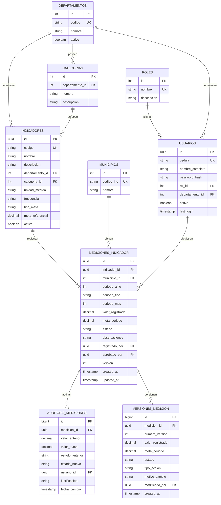

# 🛢️ Modelo de Base de Datos Relacional - Sistema de Indicadores INE Estado Monagas

## 📌 1. Visión General
Este documento define el diseño relacional optimizado para el **Sistema de Indicadores del Instituto Nacional de Estadística (INE) - Estado Monagas**. 

El diseño satisface los siguientes requerimientos principales:
- **Multi-departamental**: Soporte estructurado para los departamentos clave (Económica, Sociales, Demográficas, Cartografía, SEGEN).
- **Control de Acceso (RBAC)**: Roles de *Administrador*, *Gerente* (acceso de supervisión y consulta a estadísticas generales y dashboards consolidados; sin tareas operativas de aprobación) y *Encargado de Unidad* (gestiona, valida y aprueba de forma autónoma las mediciones de su propio departamento).
- **Gestión de Indicadores y Mediciones**: Definición flexible de indicadores por frecuencia (mensual, trimestral, semestral, anual), unidad de medida, metas y estado de aprobación.
- **Desglose Territorial (Estado Monagas)**: Cobertura geográfica por Municipios del Estado Monagas (Maturín, Bolívar, Caripe, Cedeño, Ezequiel Zamora, Libertador, Piar, Punceres, Acosta, Aguasay, Santa Bárbara, Sotillo, Uracoa).
- **Auditoría e Historial**: Trazabilidad completa de quién ingresó, modificó o aprobó cada dato.
- **Optimizaciones para Dashboards**: Índices estratégicos y Vistas SQL para alimentar dashboards ejecutivos por departamento y el Dashboard Central Consolidado.

---

## 📊 2. Diagrama Entidad-Relación (ERD)



---

## 🗄️ 3. Script DDL en PostgreSQL

```sql
-- =============================================================================
-- SISTEMA DE INDICADORES - INE ESTADO MONAGAS
-- SCRIPT DE CREACIÓN DE BASE DE DATOS (PostgreSQL)
-- =============================================================================

-- Habilitar extensión UUID
CREATE EXTENSION IF NOT EXISTS "uuid-ossp";

-- -----------------------------------------------------------------------------
-- TIPOS ENUMERADOS (ENUMS)
-- -----------------------------------------------------------------------------
CREATE TYPE tipo_frecuencia AS ENUM ('MENSUAL', 'TRIMESTRAL', 'SEMESTRAL', 'ANUAL');
CREATE TYPE tipo_orientacion_meta AS ENUM ('ASCENDENTE', 'DESCENDENTE', 'RANGO');
CREATE TYPE estado_medicion AS ENUM ('BORRADOR', 'ENVIADO', 'APROBADO', 'RECHAZADO');

-- -----------------------------------------------------------------------------
-- TABLA: ROLES
-- -----------------------------------------------------------------------------
CREATE TABLE roles (
    id SERIAL PRIMARY KEY,
    nombre VARCHAR(50) NOT NULL UNIQUE,
    descripcion TEXT,
    created_at TIMESTAMP WITH TIME ZONE DEFAULT CURRENT_TIMESTAMP
);

-- -----------------------------------------------------------------------------
-- TABLA: DEPARTAMENTOS
-- -----------------------------------------------------------------------------
CREATE TABLE departamentos (
    id SERIAL PRIMARY KEY,
    codigo VARCHAR(20) NOT NULL UNIQUE, -- ECO, SOC, DEM, CART, SEG
    nombre VARCHAR(100) NOT NULL,
    descripcion TEXT,
    activo BOOLEAN DEFAULT TRUE,
    created_at TIMESTAMP WITH TIME ZONE DEFAULT CURRENT_TIMESTAMP
);

-- -----------------------------------------------------------------------------
-- TABLA: USUARIOS
-- -----------------------------------------------------------------------------
CREATE TABLE usuarios (
    id UUID PRIMARY KEY DEFAULT uuid_generate_v4(),
    cedula VARCHAR(20) NOT NULL UNIQUE,
    nombre_completo VARCHAR(150) NOT NULL,
    password_hash VARCHAR(255) NOT NULL,
    rol_id INT NOT NULL REFERENCES roles(id) ON DELETE RESTRICT,
    departamento_id INT REFERENCES departamentos(id) ON DELETE SET NULL, -- NULL para Gerentes y Admins
    activo BOOLEAN DEFAULT TRUE,
    ultimo_ingreso TIMESTAMP WITH TIME ZONE,
    created_at TIMESTAMP WITH TIME ZONE DEFAULT CURRENT_TIMESTAMP,
    updated_at TIMESTAMP WITH TIME ZONE DEFAULT CURRENT_TIMESTAMP
);

-- -----------------------------------------------------------------------------
-- TABLA: MUNICIPIOS (ESTADO MONAGAS)
-- -----------------------------------------------------------------------------
CREATE TABLE municipios (
    id SERIAL PRIMARY KEY,
    codigo_ine VARCHAR(10) NOT NULL UNIQUE,
    nombre VARCHAR(100) NOT NULL,
    created_at TIMESTAMP WITH TIME ZONE DEFAULT CURRENT_TIMESTAMP
);

-- -----------------------------------------------------------------------------
-- TABLA: CATEGORIAS DE INDICADORES
-- -----------------------------------------------------------------------------
CREATE TABLE categorias (
    id SERIAL PRIMARY KEY,
    departamento_id INT NOT NULL REFERENCES departamentos(id) ON DELETE CASCADE,
    nombre VARCHAR(100) NOT NULL,
    descripcion TEXT,
    created_at TIMESTAMP WITH TIME ZONE DEFAULT CURRENT_TIMESTAMP,
    CONSTRAINT uk_categoria_departamento UNIQUE (departamento_id, nombre)
);

-- -----------------------------------------------------------------------------
-- TABLA: INDICADORES
-- -----------------------------------------------------------------------------
CREATE TABLE indicadores (
    id UUID PRIMARY KEY DEFAULT uuid_generate_v4(),
    codigo VARCHAR(30) NOT NULL UNIQUE, -- Ej: ECO-001, DEM-003
    nombre VARCHAR(200) NOT NULL,
    descripcion TEXT,
    departamento_id INT NOT NULL REFERENCES departamentos(id) ON DELETE RESTRICT,
    categoria_id INT REFERENCES categorias(id) ON DELETE SET NULL,
    unidad_medida VARCHAR(50) NOT NULL, -- Porcentaje, Hab., Bs., M², etc.
    frecuencia tipo_frecuencia NOT NULL DEFAULT 'MENSUAL',
    tipo_meta tipo_orientacion_meta NOT NULL DEFAULT 'ASCENDENTE',
    meta_referencial NUMERIC(14, 4),
    activo BOOLEAN DEFAULT TRUE,
    created_at TIMESTAMP WITH TIME ZONE DEFAULT CURRENT_TIMESTAMP,
    updated_at TIMESTAMP WITH TIME ZONE DEFAULT CURRENT_TIMESTAMP
);

-- -----------------------------------------------------------------------------
-- TABLA: MEDICIONES DE INDICADORES (DATOS CARGADOS)
-- -----------------------------------------------------------------------------
CREATE TABLE mediciones_indicador (
    id UUID PRIMARY KEY DEFAULT uuid_generate_v4(),
    indicador_id UUID NOT NULL REFERENCES indicadores(id) ON DELETE CASCADE,
    municipio_id INT REFERENCES municipios(id) ON DELETE SET NULL, -- NULL indica nivel estadal consolidado
    periodo_anio INT NOT NULL CHECK (periodo_anio BETWEEN 2000 AND 2100),
    periodo_tipo tipo_frecuencia NOT NULL,
    periodo_mes INT NOT NULL CHECK (periodo_mes BETWEEN 1 AND 12), -- Mes 1..12
    valor_registrado NUMERIC(16, 4) NOT NULL,
    meta_periodo NUMERIC(16, 4),
    estado estado_medicion NOT NULL DEFAULT 'BORRADOR',
    observaciones TEXT,
    registrado_por UUID NOT NULL REFERENCES usuarios(id) ON DELETE RESTRICT,
    aprobado_por UUID REFERENCES usuarios(id) ON DELETE SET NULL,
    version INT NOT NULL DEFAULT 1,
    created_at TIMESTAMP WITH TIME ZONE DEFAULT CURRENT_TIMESTAMP,
    updated_at TIMESTAMP WITH TIME ZONE DEFAULT CURRENT_TIMESTAMP,
    CONSTRAINT uk_medicion_periodo UNIQUE (indicador_id, municipio_id, periodo_anio, periodo_tipo, periodo_mes)
);

-- -----------------------------------------------------------------------------
-- TABLA: VERSIONES DE MEDICIONES (SNAPSHOTS INMUTABLES Y ROLLBACK)
-- -----------------------------------------------------------------------------
CREATE TABLE versiones_medicion (
    id BIGSERIAL PRIMARY KEY,
    medicion_id UUID NOT NULL REFERENCES mediciones_indicador(id) ON DELETE CASCADE,
    numero_version INT NOT NULL,
    valor_registrado NUMERIC(16, 4) NOT NULL,
    meta_periodo NUMERIC(16, 4),
    estado estado_medicion NOT NULL,
    observaciones TEXT,
    tipo_accion VARCHAR(20) NOT NULL DEFAULT 'MODIFICACION',
    motivo_cambio TEXT,
    modificado_por UUID REFERENCES usuarios(id) ON DELETE SET NULL,
    created_at TIMESTAMP WITH TIME ZONE DEFAULT CURRENT_TIMESTAMP,
    CONSTRAINT uk_medicion_version UNIQUE (medicion_id, numero_version)
);

CREATE INDEX idx_versiones_medicion_id ON versiones_medicion(medicion_id);
CREATE INDEX idx_versiones_fecha ON versiones_medicion(created_at);

-- -----------------------------------------------------------------------------
-- TABLA: AUDITORIA DE MEDICIONES
-- -----------------------------------------------------------------------------
CREATE TABLE auditoria_mediciones (
    id BIGSERIAL PRIMARY KEY,
    medicion_id UUID NOT NULL REFERENCES mediciones_indicador(id) ON DELETE CASCADE,
    valor_anterior NUMERIC(16, 4),
    valor_nuevo NUMERIC(16, 4),
    estado_anterior VARCHAR(30),
    estado_nuevo VARCHAR(30),
    usuario_id UUID NOT NULL REFERENCES usuarios(id) ON DELETE RESTRICT,
    justificacion TEXT NOT NULL,
    fecha_cambio TIMESTAMP WITH TIME ZONE DEFAULT CURRENT_TIMESTAMP
);

-- -----------------------------------------------------------------------------
-- ÍNDICES DE ALTO RENDIMIENTO PARA DASHBOARDS
-- -----------------------------------------------------------------------------
CREATE INDEX idx_indicadores_dept ON indicadores(departamento_id);
CREATE INDEX idx_mediciones_indicador ON mediciones_indicador(indicador_id);
CREATE INDEX idx_mediciones_periodo ON mediciones_indicador(periodo_anio, periodo_tipo, periodo_mes);
CREATE INDEX idx_mediciones_estado ON mediciones_indicador(estado);
CREATE INDEX idx_mediciones_municipio ON mediciones_indicador(municipio_id);
CREATE INDEX idx_usuarios_dept_rol ON usuarios(departamento_id, rol_id);
```

---

## 📈 4. Vistas SQL para Dashboards Ejecutivos y Central

### A. Vista Dashboard Central (Consolidado General para la Gerencia)
```sql
CREATE OR REPLACE VIEW v_dashboard_central_resumen AS
SELECT 
    d.id AS departamento_id,
    d.codigo AS departamento_codigo,
    d.nombre AS departamento_nombre,
    COUNT(DISTINCT i.id) AS total_indicadores,
    COUNT(m.id) AS total_mediciones_registradas,
    COUNT(CASE WHEN m.estado = 'APROBADO' THEN 1 END) AS mediciones_aprobadas,
    COUNT(CASE WHEN m.estado = 'ENVIADO' THEN 1 END) AS mediciones_pendientes_aprobacion,
    ROUND(
        AVG(
            CASE 
                WHEN m.meta_periodo IS NOT NULL AND m.meta_periodo > 0 
                THEN (m.valor_registrado / m.meta_periodo) * 100 
                ELSE NULL 
            END
        ), 2
    ) AS porcentaje_cumplimiento_promedio
FROM departamentos d
LEFT JOIN indicadores i ON i.departamento_id = d.id AND i.activo = TRUE
LEFT JOIN mediciones_indicador m ON m.indicador_id = i.id
WHERE d.activo = TRUE
GROUP BY d.id, d.codigo, d.nombre;
```

### B. Vista Dashboard Departamental Ejecutiva
```sql
CREATE OR REPLACE VIEW v_dashboard_ejecutivo_departamental AS
SELECT 
    i.id AS indicador_id,
    i.codigo AS indicador_codigo,
    i.nombre AS indicador_nombre,
    i.unidad_medida,
    d.nombre AS departamento_nombre,
    c.nombre AS categoria_nombre,
    m.periodo_anio,
    m.periodo_tipo,
    m.periodo_mes,
    m.valor_registrado,
    m.meta_periodo,
    ROUND(
        CASE 
            WHEN m.meta_periodo IS NOT NULL AND m.meta_periodo > 0 
            THEN (m.valor_registrado / m.meta_periodo) * 100 
            ELSE 0 
        END, 2
    ) AS porcentaje_cumplimiento,
    m.estado AS estado_medicion,
    mun.nombre AS municipio_nombre,
    u.nombre_completo AS registrado_por_nombre
FROM mediciones_indicador m
JOIN indicadores i ON m.indicador_id = i.id
JOIN departamentos d ON i.departamento_id = d.id
LEFT JOIN categorias c ON i.categoria_id = c.id
LEFT JOIN municipios mun ON m.municipio_id = mun.id
LEFT JOIN usuarios u ON m.registrado_por = u.id;
```

---

## 🌱 5. Datos Semilla (Seed Data Inicial)

```sql
-- Insertar Roles
INSERT INTO roles (nombre, descripcion) VALUES
('ADMIN', 'Administrador total del sistema'),
('GERENTE', 'Gerente/Director con acceso a todos los dashboards ejecutivos'),
('ENCARGADO', 'Encargado de ingresar y validar datos de su departamento');

-- Insertar Departamentos INE Monagas
INSERT INTO departamentos (codigo, nombre, descripcion) VALUES
('ECO', 'Económica', 'Indicadores de actividad económica, comercio, empleo e inflación'),
('SOC', 'Sociales', 'Indicadores de educación, salud, vivienda y servicios públicos'),
('DEM', 'Demográficas', 'Indicadores de población, natalidad, mortalidad y migración'),
('CART', 'Cartografía', 'Indicadores de cobertura geográfica, centros poblados y catastro'),
('SEG', 'SEGEN', 'Secretaría General y gestión administrativa institucional');

-- Insertar Municipios del Estado Monagas (Entidad 16 - DPT Oficial INE)
INSERT INTO municipios (id, codigo_ine, nombre) VALUES
(1, '1601', 'Acosta'),
(2, '1602', 'Aguasay'),
(3, '1603', 'Bolívar'),
(4, '1604', 'Caripe'),
(5, '1605', 'Cedeño'),
(6, '1606', 'Ezequiel Zamora'),
(7, '1607', 'Libertador'),
(8, '1608', 'Maturín'),
(9, '1609', 'Piar'),
(10, '1610', 'Punceres'),
(11, '1611', 'Santa Bárbara'),
(12, '1612', 'Sotillo'),
(13, '1613', 'Uracoa');
```

---

## ⏪ 6. Control de Versiones, Diagnóstico de Causas y Reversión (Rollback)

Para proteger la integridad de las estadísticas del INE Monagas ante errores humanos o inconsistencias en una fecha/periodo en particular, el sistema implementa un motor de **versionado automático inmutable**:

### A. Funcionamiento del Versionado
1. **Snapshots Automáticos**: Cada inserción o actualización sobre una medición (`mediciones_indicador`) dispara el trigger `trg_versionar_medicion`, que crea un registro inmutable en `versiones_medicion` con:
   * `numero_version`: Número secuencial (1, 2, 3...).
   * `tipo_accion`: `CREACION`, `MODIFICACION`, `REVERSION` o `APROBACION`.
   * `motivo_cambio`: Descripción o justificación obligatoria del cambio.
   * `modificado_por`: Usuario responsable de la acción.
2. **Detección de la Causa del Error**: Mediante la vista `v_historial_versiones_indicador` es posible consultar cronológicamente todas las versiones de un indicador en un mes específico para identificar:
   * Quién introdujo el valor anómalo (`modificado_por_nombre`, `modificado_por_cedula`).
   * Qué valor exacto fue alterado y en qué porcentaje distorsionó el cumplimiento.
   * La fecha y hora exacta del incidente.

### B. Procedimiento de Reversión (Rollback)
Para restaurar una medición a una versión previa sana, se invoca la función almacenada:

```sql
SELECT fn_revertir_medicion(
    'c0000000-0000-0000-0000-000000000004', -- ID de la medición
    1,                                      -- Versión previa a la que se desea regresar
    'a0000000-0000-0000-0000-000000000004', -- ID del usuario que ejecuta la reversión
    'Corrección de error de tipeo en las viviendas del mes de agosto'
);
```

**Garantías de Integridad**:
* El rollback **no borra la versión dañada**, sino que genera una nueva versión (ej. versión 3) de tipo `REVERSION`, preservando la auditoría forense completa.
* La vista ejecutiva del Gerente se actualiza instantáneamente con las cifras restauradas.

